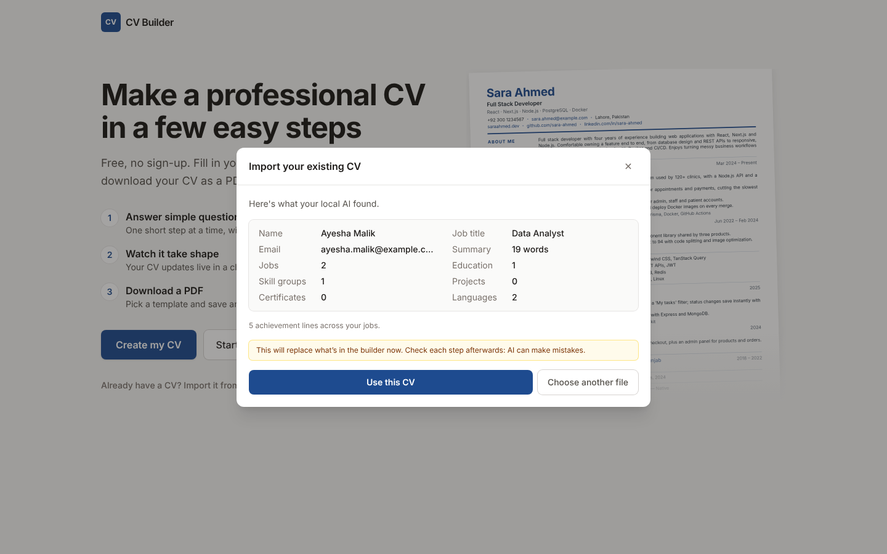
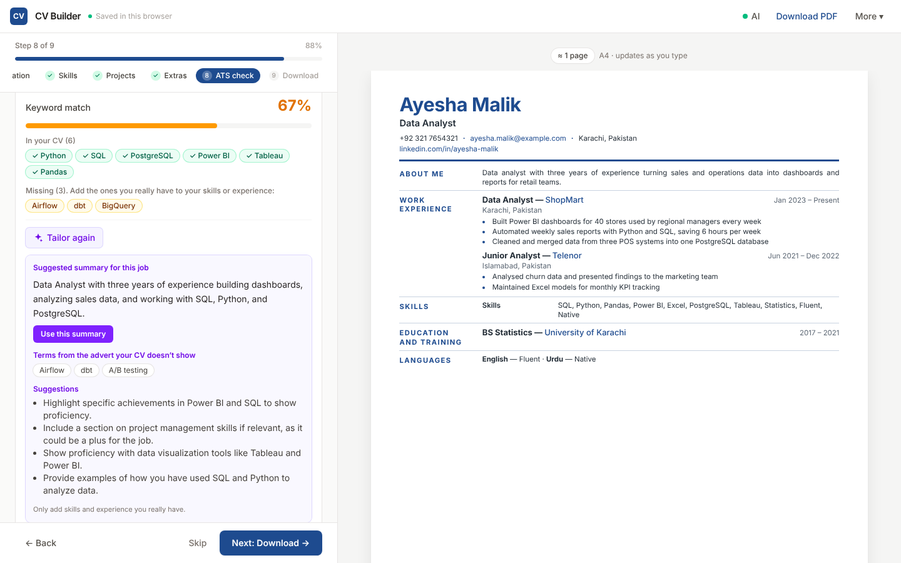

# CV Builder

Build an ATS-friendly CV step by step, import your old CV from PDF or Word, and improve it with **local AI (Ollama)**. Your data never leaves your computer. Built with Next.js, React and Tailwind CSS.

**Live:** https://fawadeqbal.github.io/cu-builder/


## How it works

1. **Start.** Create a new CV, begin from an example, or import your existing CV (PDF, Word, text or a backup).
2. **Fill it in, one step at a time.** Details → Summary → Experience → Education → Skills → Projects → Extras. Each step has short tips, and the live preview updates as you type.
3. **Beat the ATS.** Paste a job advert to see matched and missing keywords, run the ATS checklist, and tailor your summary with AI.
4. **Choose a design and download.** Pick a template, run the CV check, and download an A4 PDF.


## Features

- **Step-by-step wizard** with a progress bar. Jump to any step, skip optional ones, and get checks on the required fields (name, job title, email).
- **Helpful inputs.** Summary starters with a word counter, quick-add skill groups, example placeholders and tips in every step.
- **Import any CV.** Text is read in the browser from PDF (pdf.js) and Word (mammoth). Local AI sorts it into sections; without AI, a basic import fills in contact details, summary and skills.
- **AI writing (local).** Write or improve your summary, and turn achievement lines into strong, action-verb bullets. Suggestions stream in and only replace your text when you click *Use this*. The prompts tell the model never to invent facts.
- **ATS tools.** A plain ATS template, an ATS checklist (layout, contact details, dates, action verbs, numbers, skills, length) and job advert keyword matching with a score.
- **Tailor to a job (AI).** Get a job-specific summary, the terms you're missing and concrete tips.
- **Three templates.**
  - **Classic:** Europass style, with section labels in a left column, a blue accent and justified text.
  - **Modern:** serif name, contact block on the right, and a two-column body with a side panel.
  - **ATS:** plain single column, standard headings, black text, best for online applications.
- **CV check** before download, with links to fix anything missing.
- **PDF export** through the browser's print engine, so the text stays selectable and links stay clickable.
- **Auto-save** in your browser (`localStorage`). There is no server or account, and you continue where you left off.
- **Backup files.** Save and import your CV as JSON.
- **Mobile friendly,** with a full-screen preview on phones.






## Getting started

```bash
npm install
npm run dev
```

Open http://localhost:3000.

## Local AI with Ollama

AI features use [Ollama](https://ollama.com) running on your own computer. The browser talks to it directly at `http://localhost:11434`, so no API keys, no cloud and no cost.

1. Install Ollama from https://ollama.com/download.
2. Download a model:
   ```bash
   ollama pull qwen2.5:7b     # best results (about 5 GB, 16 GB RAM)
   ollama pull qwen2.5:3b     # faster, for 8 GB RAM laptops
   ```
3. **If you use the hosted site** (not `localhost`), allow it to call Ollama, then restart Ollama:
   ```bash
   # macOS
   launchctl setenv OLLAMA_ORIGINS "https://fawadeqbal.github.io"
   # Windows (PowerShell)
   setx OLLAMA_ORIGINS "https://fawadeqbal.github.io"
   # Linux (systemd): sudo systemctl edit ollama.service, add
   #   [Service]
   #   Environment="OLLAMA_ORIGINS=https://fawadeqbal.github.io"
   # then: sudo systemctl restart ollama
   ```
4. Click **AI** in the top bar, then **Connect**, and pick your model.

Running the app locally with `npm run dev` works without step 3, because Ollama already allows `localhost`. Use Chrome, Edge or Firefox. Safari blocks a secure website from calling `http://localhost`.

## Downloading the PDF

1. Click **Download PDF**.
2. In the print window, choose **Save as PDF** as the destination.
3. Turn off **Headers and footers** (under "More settings").
4. Save.

Chrome and Edge give the best result.

## Project structure

```
src/
├── app/
│   ├── globals.css        # app styles, both templates and print rules (@page A4)
│   ├── layout.tsx         # fonts (Inter, Source Serif 4) and metadata
│   └── page.tsx
├── components/
│   ├── ai/
│   │   ├── AiProvider.tsx       # Ollama connection state, model list, status button
│   │   ├── AiSettingsDialog.tsx # address, model picker, setup help
│   │   └── AiAssist.tsx         # "write / improve with AI" with streaming suggestions
│   ├── AtsStep.tsx        # keyword match, ATS checklist, AI tailoring
│   ├── ImportDialog.tsx   # import PDF / Word / text / JSON
│   ├── Modal.tsx
│   ├── Builder.tsx        # app shell: welcome or wizard, preview, import/export, PDF, auto-save
│   ├── BuilderLoader.tsx  # client-only loading (reads localStorage)
│   ├── Welcome.tsx        # start screen
│   ├── Wizard.tsx         # progress bar, step content, tips, validation, Back/Next
│   ├── sections.tsx       # the form for each step
│   ├── FinishStep.tsx     # template picker, CV check, download
│   ├── fields.tsx         # inputs and list item cards
│   └── Preview.tsx        # scaled A4 preview and page counter
├── lib/
│   ├── ai.ts              # Ollama client: models, chat, streaming, JSON schema output
│   ├── prompts.ts         # extraction, writing and tailoring prompts and schemas
│   ├── ats.ts             # ATS checklist and keyword matching
│   ├── extract.ts         # text from PDF, DOCX, TXT
│   ├── parse.ts           # basic import without AI
│   ├── cv.ts              # helpers, JSON validation, storage, template list
│   ├── sample.ts          # example CV
│   ├── steps.ts           # wizard steps, titles and tips
│   └── types.ts           # CV data types
└── templates/
    ├── AtsTemplate.tsx
    ├── ClassicTemplate.tsx
    ├── ModernTemplate.tsx
    └── index.tsx          # picks the template to render
```

## Adding a new template

1. Create `src/templates/MyTemplate.tsx`. It receives `{ cv }` and returns the markup.
2. Add its styles to `globals.css` under a unique class, for example `.tpl-mine`.
3. Add it to `TemplateId` in `lib/types.ts`, to `TEMPLATES` in `lib/cv.ts` and to `templates/index.tsx`.

## JSON format

Use **Export JSON** to see the full structure. In short:

```json
{
  "personal": { "name": "", "headline": "", "tagline": "", "email": "", "phone": "",
                "location": "", "website": "", "github": "", "linkedin": "", "extra": "" },
  "summary": "",
  "experience": [{ "role": "", "company": "", "location": "", "date": "", "bullets": [], "stack": "" }],
  "projects":   [{ "name": "", "date": "", "links": [], "bullets": [], "stack": "" }],
  "skills":     [{ "category": "", "items": "" }],
  "education":  [{ "degree": "", "school": "", "date": "", "details": "" }],
  "certificates": [{ "name": "", "issuer": "", "year": "", "url": "" }],
  "languages":  [{ "name": "", "level": "" }]
}
```

## Deploy

The app is exported as a static site (`output: "export"`), so it can be hosted anywhere.

**GitHub Pages (set up):** every push to `main` runs `.github/workflows/deploy.yml`, which lints, builds and publishes the `out/` folder. In the repository go to **Settings → Pages** and set **Source** to **GitHub Actions** (only needed once).

**Vercel / Netlify:** import the repository and deploy. The build command is `npm run build` and the output folder is `out`.

## Roadmap

- More templates and accent colours
- Section ordering and hiding
- Multiple saved CVs (one per job application)
- AI cover letter from the CV and job advert
- OCR for scanned PDF CVs
