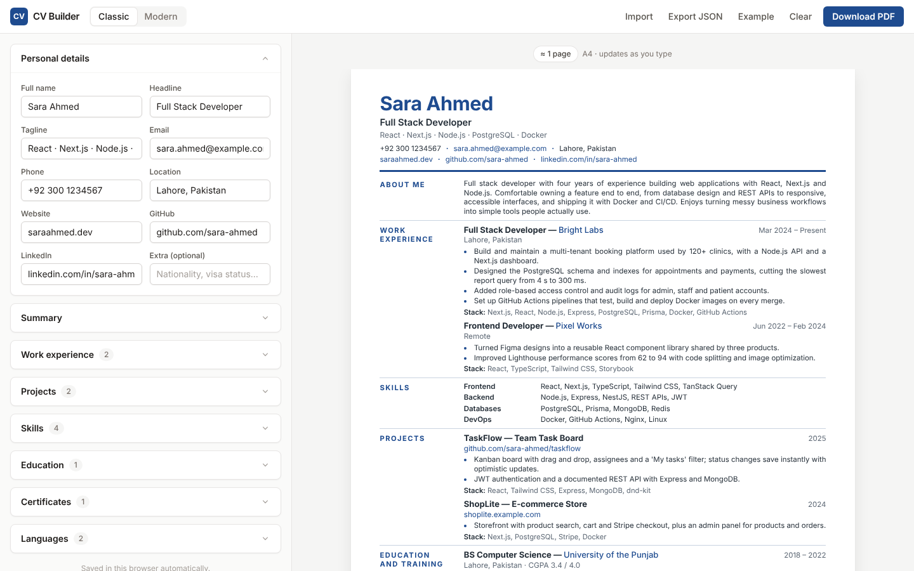
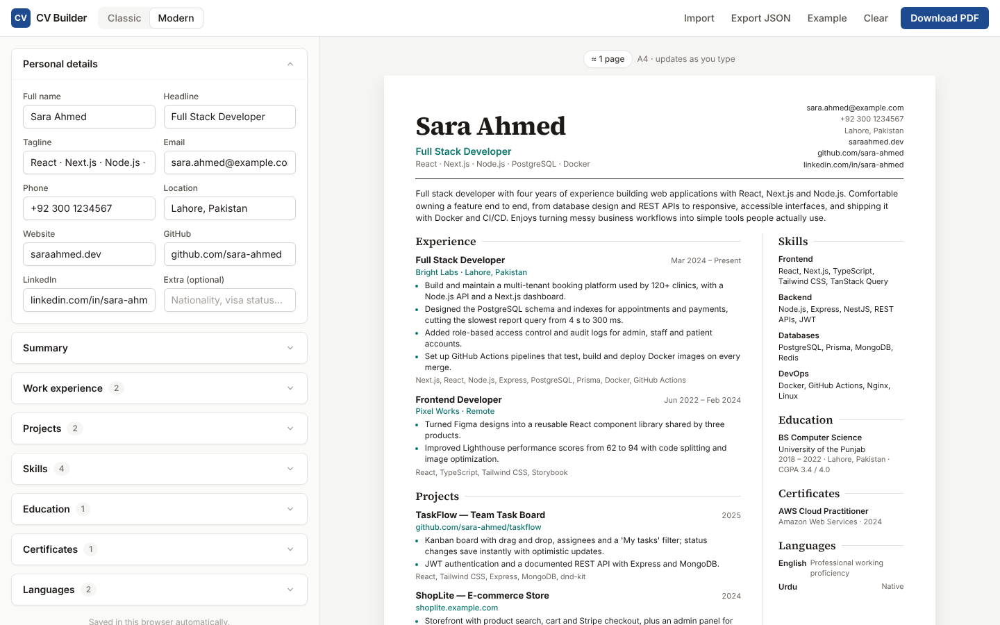

# CV Builder

Write your CV once, switch between templates, and download a clean A4 PDF. Built with Next.js, React and Tailwind CSS.

**Live:** https://fawadeqbal.github.io/cu-builder/



## Features

- **Live editor.** Personal details, summary, work experience, projects, skills, education, certificates and languages. The preview updates as you type.
- **Two templates.**
  - **Classic:** Europass style, with section labels in a left column, a blue accent and justified text.
  - **Modern:** serif name, contact block on the right, and a two-column body with a side panel for skills and education.
- **PDF export.** Uses the browser's print engine, so the text stays selectable and links stay clickable.
- **Page counter.** An approximate page count, so you can keep your CV to one or two pages.
- **Auto-save.** Your CV is stored in your browser (`localStorage`). There is no server or account.
- **Import / export JSON.** Back up your CV, move it to another computer, or keep several versions.
- **Reorder anything.** Move entries up and down, add new ones or remove them.
- **Works on phones.** Separate Edit and Preview tabs.



## Getting started

```bash
npm install
npm run dev
```

Open http://localhost:3000.

## Downloading the PDF

1. Click **Download PDF**.
2. In the print window, choose **Save as PDF** as the destination.
3. Turn off **Headers and footers** (under "More settings").
4. Save.

Chrome and Edge give the best result.

## Project structure

```
src/
├── app/
│   ├── globals.css        # app styles, both templates and print rules (@page A4)
│   ├── layout.tsx         # fonts (Inter, Source Serif 4) and metadata
│   └── page.tsx
├── components/
│   ├── Builder.tsx        # toolbar, template switch, import/export, PDF, auto-save
│   ├── BuilderLoader.tsx  # client-only loading (reads localStorage)
│   ├── Editor.tsx         # all form sections
│   ├── fields.tsx         # inputs, panels and list item cards
│   └── Preview.tsx        # scaled A4 preview and page counter
├── lib/
│   ├── cv.ts              # helpers, JSON validation, storage, template list
│   ├── sample.ts          # example CV shown on first visit
│   └── types.ts           # CV data types
└── templates/
    ├── ClassicTemplate.tsx
    ├── ModernTemplate.tsx
    └── index.tsx          # picks the template to render
```

## Adding a new template

1. Create `src/templates/MyTemplate.tsx`. It receives `{ cv }` and returns the markup.
2. Add its styles to `globals.css` under a unique class, for example `.tpl-mine`.
3. Add it to `TemplateId` in `lib/types.ts`, to `TEMPLATES` in `lib/cv.ts` and to `templates/index.tsx`.

## JSON format

Use **Export JSON** to see the full structure. In short:

```json
{
  "personal": { "name": "", "headline": "", "tagline": "", "email": "", "phone": "",
                "location": "", "website": "", "github": "", "linkedin": "", "extra": "" },
  "summary": "",
  "experience": [{ "role": "", "company": "", "location": "", "date": "", "bullets": [], "stack": "" }],
  "projects":   [{ "name": "", "date": "", "links": [], "bullets": [], "stack": "" }],
  "skills":     [{ "category": "", "items": "" }],
  "education":  [{ "degree": "", "school": "", "date": "", "details": "" }],
  "certificates": [{ "name": "", "issuer": "", "year": "", "url": "" }],
  "languages":  [{ "name": "", "level": "" }]
}
```

## Deploy

The app is exported as a static site (`output: "export"`), so it can be hosted anywhere.

**GitHub Pages (set up):** every push to `main` runs `.github/workflows/deploy.yml`, which lints, builds and publishes the `out/` folder. In the repository go to **Settings → Pages** and set **Source** to **GitHub Actions** (only needed once).

**Vercel / Netlify:** import the repository and deploy. The build command is `npm run build` and the output folder is `out`.

## Roadmap

- More templates and accent colours
- Section ordering and hiding
- Multiple saved CVs
- AI help to tailor a CV to a job description
