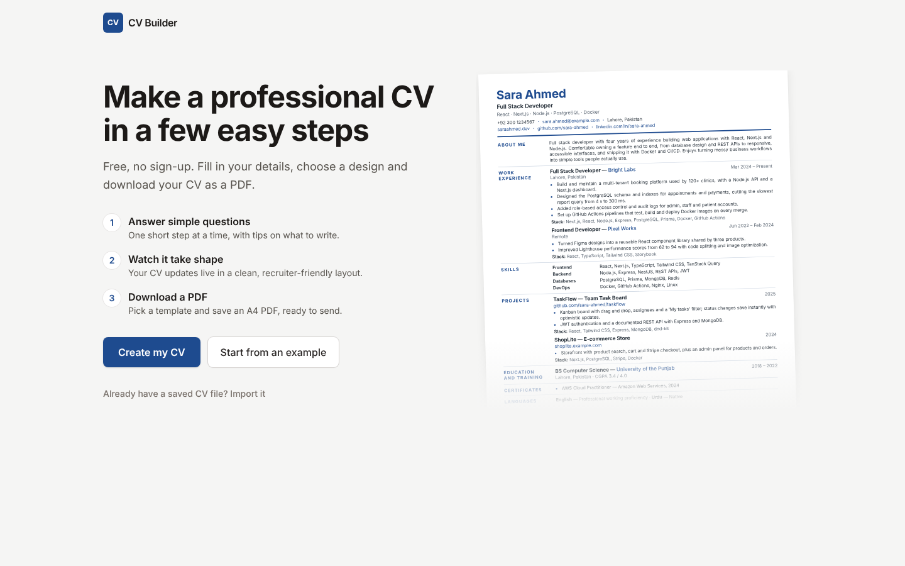
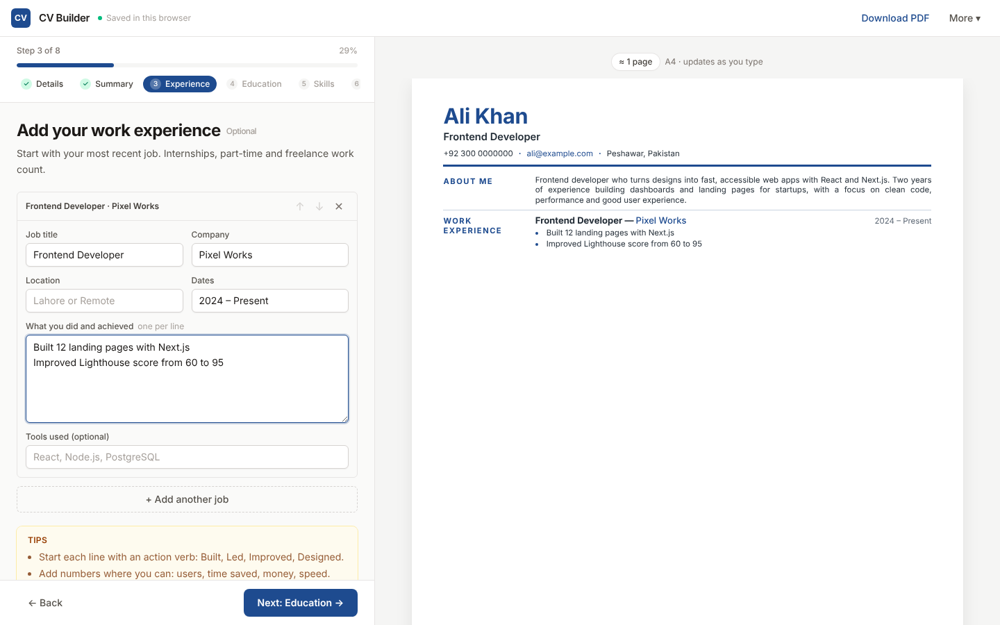
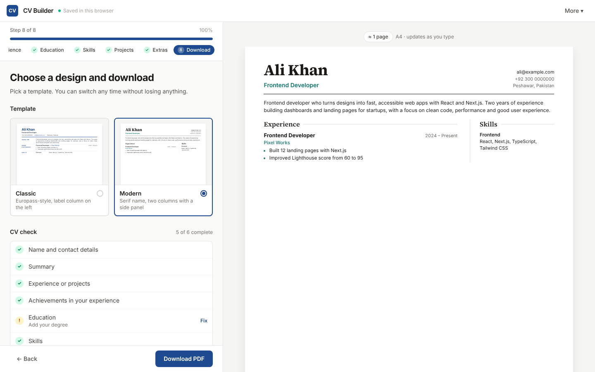

# CV Builder

Write your CV once, switch between templates, and download a clean A4 PDF. Built with Next.js, React and Tailwind CSS.

**Live:** https://fawadeqbal.github.io/cu-builder/



## How it works

1. **Start.** Create a new CV, begin from an example, or import a saved backup.
2. **Fill it in, one step at a time.** Details → Summary → Experience → Education → Skills → Projects → Extras. Each step has short tips, and the live preview updates as you type.
3. **Choose a design and download.** Pick a template, run the CV check, and download an A4 PDF.



## Features

- **Step-by-step wizard with a step rail.** Every step is listed on the left with its icon and what it holds ("2 jobs", "51 words"), done steps are ticked, and a CV-strength ring shows how close you are. The rail turns into icons when the editor is narrow and into a dropdown on phones. Required fields (name, job title, email) are checked before you move on.
- **Helpful inputs.** Summary starters with a word counter, quick-add skill groups, example placeholders and tips in every step.
- **12 templates in four tiers,** browsed on their own page (`/templates`):
  - **Basic:** Simple, Compact, Classic
  - **Standard:** Modern, Timeline, Nordic
  - **Premium:** Sidebar Pro, Developer, Creative
  - **Executive:** Elegant, Executive, Boardroom

  Filter by tier, style (Professional, Modern, Creative, Minimal, Executive), layout (one column, two columns, sidebar) and ATS-friendliness. Recolour every thumbnail with 12 accent colours, preview with your own CV or the example, open a large preview (← → to browse), and pick one. Quick switching also lives in the preview toolbar and on the Download step. All tiers are free for now; `isUnlocked()` in `components/TemplateBadge.tsx` is the hook for paid plans.
- **CV check** before download, with links to fix anything missing.
- **One-click PDF download,** built in the browser with [modern-screenshot](https://github.com/qq15725/modern-screenshot) and [jsPDF](https://github.com/parallax/jsPDF): no print dialog. Pages break between lines and entries, the text stays selectable and searchable (an invisible text layer sits over the page image, so applicant tracking systems can read it), and links stay clickable.
- **Auto-save** in your browser (`localStorage`). There is no server or account, and you continue where you left off.
- **Backup files.** Save and import your CV as JSON.
- **Three views, one workspace.** Switch between **Edit**, **Split** and **Preview** from the header (`Alt+1` / `Alt+2` / `Alt+3`, or `Ctrl/⌘ + \` to show or hide the preview).
  - Drag the divider to resize. It snaps to the default width and to the middle, and double-click resets it. Drag a pane past its edge to hide it.
  - Swap sides to put the preview on the left. Your layout is remembered.
  - Zoom the preview with − / +, `Ctrl/⌘` + scroll or pinch, or fit it to the width or the whole page.
  - **Click any part of the preview to edit it.** The wizard jumps to that step, and the section you are editing is highlighted and scrolled into view.
  - In Edit view, a live thumbnail in the corner takes you back to the preview.
- **Mobile friendly,** with Edit / Preview tabs on phones.



## Getting started

```bash
npm install
npm run dev
```

Open http://localhost:3000.

## Downloading the PDF

Click **Download PDF**. The file (`your-name-cv.pdf`, A4, 10/12 mm margins) is built in your browser in a second or two and saved straight away. Nothing is uploaded.

How it works (`src/lib/pdf.ts`): the CV is laid out off-screen at the printed width, drawn to a high-resolution image by the browser itself (so fonts and colours match the preview exactly), cut into A4 pages at clean gaps between lines and entries, and placed in a PDF with jsPDF. Every line of text is then written over the image as invisible PDF text, and every link becomes a clickable link.

Want a fully vector PDF instead? Open **⋯ → Print or save with the browser**, choose **Save as PDF**, and turn off **Headers and footers**.

## Project structure

```
src/
├── app/
│   ├── globals.css        # app styles, both templates and print rules (@page A4)
│   ├── layout.tsx         # fonts (Inter, Source Serif 4, JetBrains Mono) and metadata
│   ├── templates/page.tsx # the template gallery page
│   └── page.tsx
├── components/
│   ├── Builder.tsx        # app shell: welcome or wizard, preview, import/export, PDF, auto-save
│   ├── BuilderLoader.tsx  # client-only loading (reads localStorage)
│   ├── SplitView.tsx      # editor + preview panes with the draggable, collapsible divider
│   ├── ViewSwitcher.tsx   # Edit / Split / Preview segmented control
│   ├── Preview.tsx        # live A4 preview: toolbar, zoom, click-to-edit, mini thumbnail
│   ├── Welcome.tsx        # start screen
│   ├── TemplateGallery.tsx # /templates: tiers, filters, colours, preview dialog
│   ├── TemplatePicker.tsx # quick template + colour menu in the preview toolbar
│   ├── TemplateBadge.tsx  # tier badges and the isUnlocked() hook
│   ├── Wizard.tsx         # progress bar, step content, tips, validation, Back/Next
│   ├── sections.tsx       # the form for each step
│   ├── FinishStep.tsx     # template picker, CV check, download
│   ├── fields.tsx         # inputs and list item cards
│   └── icons.tsx          # small inline SVG icons
├── lib/
│   ├── cv.ts              # helpers, JSON validation, storage, template list
│   ├── progress.ts        # CV check, CV strength and each step's status line
│   ├── pdf.ts             # direct PDF download: render, paginate, text layer, links
│   ├── layout.ts          # view mode, pane width, side and zoom (saved separately from the CV)
│   ├── sample.ts          # example CV
│   ├── steps.ts           # wizard steps, titles and tips
│   └── types.ts           # CV data types
└── templates/
    ├── catalog.ts         # every template's tier, style, layout, ATS flag and accent; accent palette
    ├── index.tsx          # CVDocument: picks the template and applies the accent
    ├── shared.tsx         # contact list, bullets, links, section wrapper
    ├── templates.css      # styles for the ten newer templates
    └── *Template.tsx      # one file per template
```

## Adding a new template

1. Create `src/templates/MyTemplate.tsx`. It receives `{ cv }` and returns the markup. Reuse the helpers in `templates/shared.tsx` (`contacts`, `Bullets`, `ProjectLinks`, `splitItems`, `Block`).
2. Wrap each section in `<Block step="…">` (`personal`, `summary`, `experience`, …) so clicking it in the preview opens the right step.
3. Add its styles to `src/templates/templates.css` under a unique prefix, and read the colour from `var(--cv-accent)` so accent colours work.
4. Add it to `TEMPLATE_IDS` and `TEMPLATES` in `templates/catalog.ts` (name, description, tier, style, layout, ATS, default accent, best for) and to `COMPONENTS` in `templates/index.tsx`.

## JSON format

Use **Export JSON** to see the full structure. In short:

```json
{
  "personal": { "name": "", "headline": "", "tagline": "", "email": "", "phone": "",
                "location": "", "website": "", "github": "", "linkedin": "", "extra": "" },
  "summary": "",
  "experience": [{ "role": "", "company": "", "location": "", "date": "", "bullets": [], "stack": "" }],
  "projects":   [{ "name": "", "date": "", "links": [], "bullets": [], "stack": "" }],
  "skills":     [{ "category": "", "items": "" }],
  "education":  [{ "degree": "", "school": "", "date": "", "details": "" }],
  "certificates": [{ "name": "", "issuer": "", "year": "", "url": "" }],
  "languages":  [{ "name": "", "level": "" }]
}
```

## Deploy

The app is exported as a static site (`output: "export"`), so it can be hosted anywhere.

**GitHub Pages (set up):** every push to `main` runs `.github/workflows/deploy.yml`, which lints, builds and publishes the `out/` folder. In the repository go to **Settings → Pages** and set **Source** to **GitHub Actions** (only needed once).

**Vercel / Netlify:** import the repository and deploy. The build command is `npm run build` and the output folder is `out`.

## Roadmap

- More templates and accent colours
- Section ordering and hiding
- Multiple saved CVs
- AI help to tailor a CV to a job description
